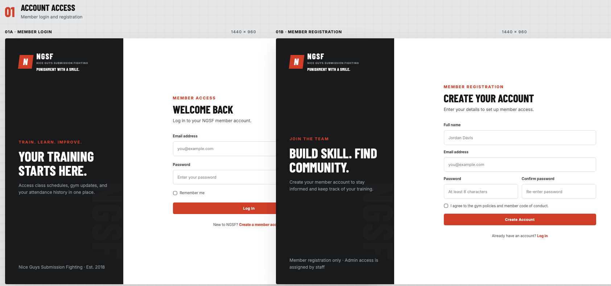
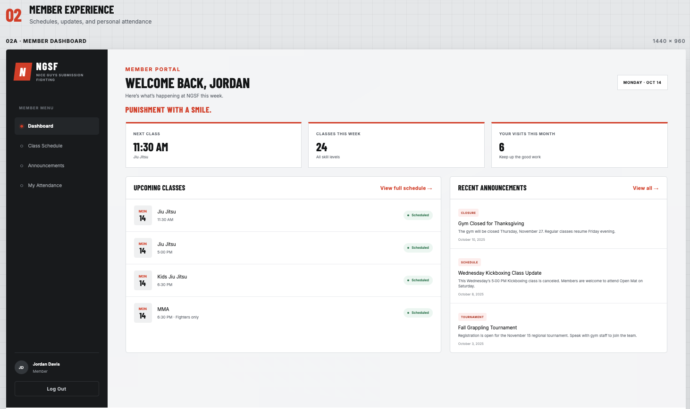
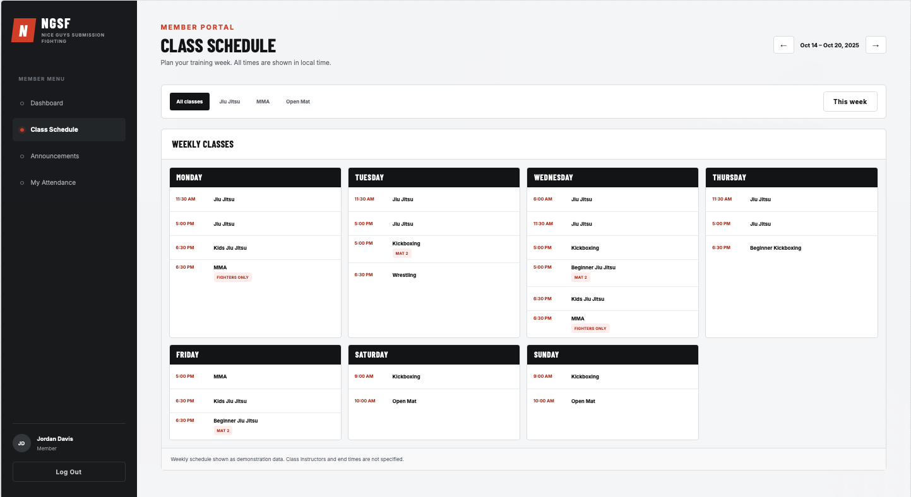
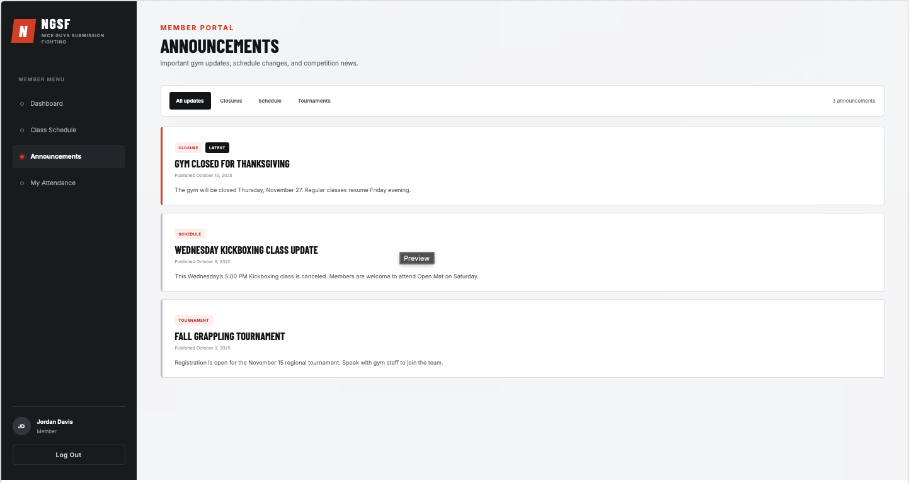
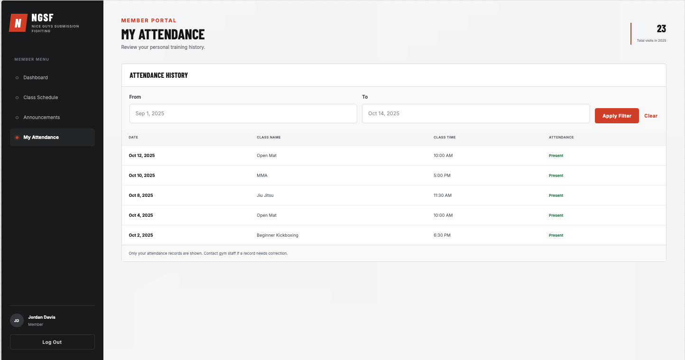
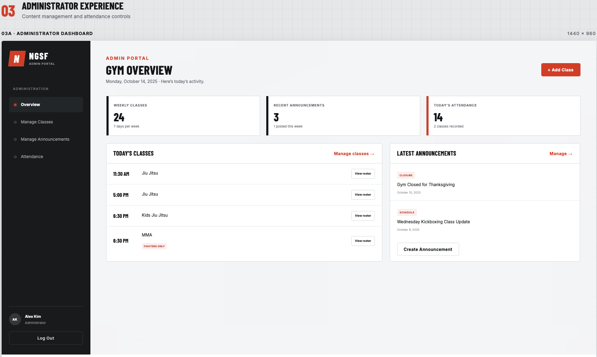
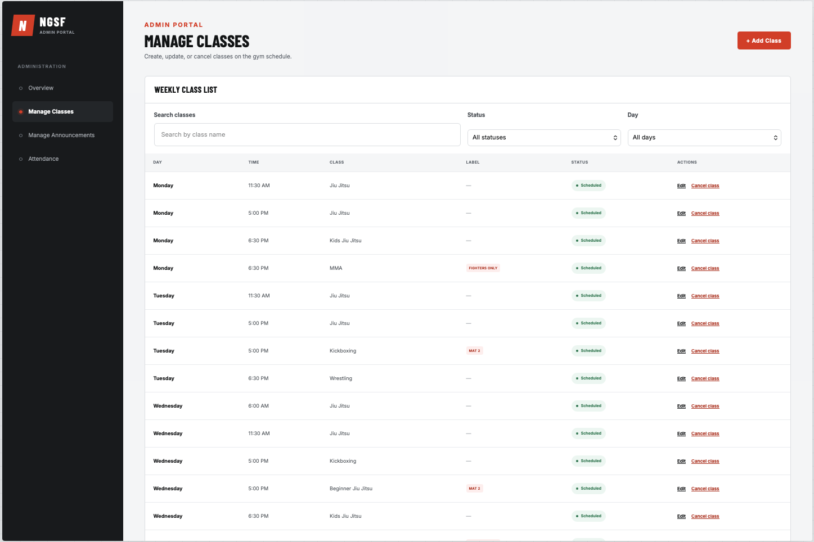
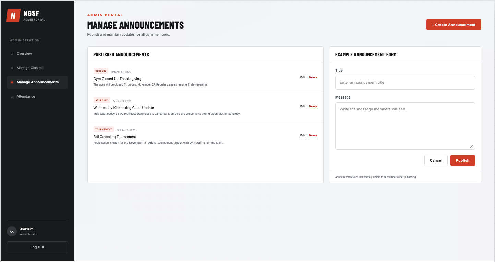
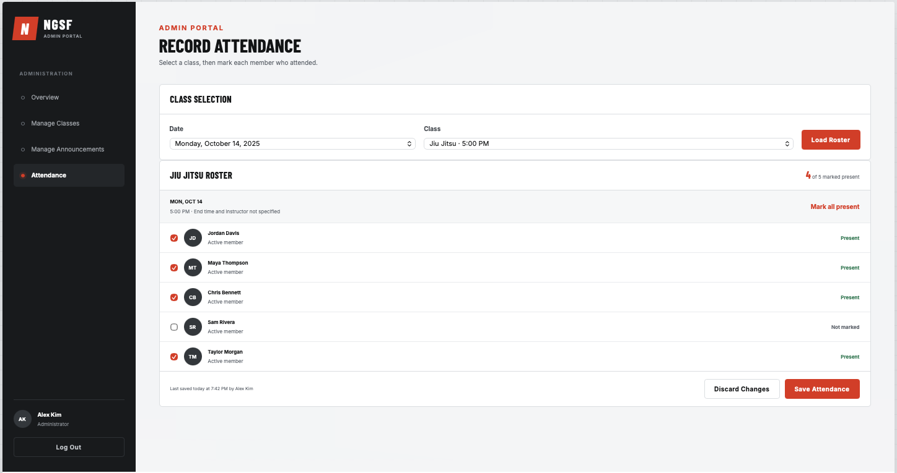

# NGSF Gym Management Website

**CS 499 · Milestone 2: React UI Prototype**

### Live Prototype URL

**https://jojofakh.github.io/Nice-Guy-Submission-Fighting-website/**

A front-end React prototype of the Nice Guy Submission Fighting website: the
public site (home, classes, schedule, pricing, contact, checkout), sign-in and
registration, the member portal, and the admin portal. It runs entirely on
mock data held in React state, so every form and button works and the screens
update immediately, but nothing is saved to a server yet. Refreshing the page
restores the starting data (you stay signed in for the browser tab).

**Demo accounts** (also listed on the login screen):

| Role          | Email             | Password   |
| ------------- | ----------------- | ---------- |
| Member        | `jordan@ngsf.com` | `ngsf2026` |
| Administrator | `alex@ngsf.com`   | `ngsf2026` |

You can also register a new account. It is always a member, and it shows up
on the admin attendance roster and "Newest accounts" table right away.

---

## Setup & Run Instructions

Requires [Node.js](https://nodejs.org/) 20.19 or newer.

```bash
git clone https://github.com/jojofakh/Nice-Guy-Submission-Fighting-website.git
cd Nice-Guy-Submission-Fighting-website
npm install
npm run dev
```

Open the URL Vite prints (http://localhost:5173/Nice-Guy-Submission-Fighting-website/).

| Command             | What it does                                         |
| ------------------- | ---------------------------------------------------- |
| `npm run dev`       | Start the Vite dev server with hot reload            |
| `npm run build`     | Type-check, then build the production site to `dist/` |
| `npm run preview`   | Serve the production build locally                   |
| `npm run lint`      | ESLint (TypeScript + React Hooks rules)              |
| `npm run typecheck` | `tsc` only                                           |
| `npm run deploy`    | Build, then publish `dist/` to the `gh-pages` branch |

### Deploying to GitHub Pages

1. `vite.config.js` sets `base: '/Nice-Guy-Submission-Fighting-website/'` so
   asset paths match the repository URL.
2. `package.json` has `"predeploy": "npm run build"` and
   `"deploy": "gh-pages -d dist"` (`gh-pages` is a dev dependency).
3. Run `npm run deploy`.
4. On GitHub: **Settings → Pages → Source: Deploy from a branch**, branch
   `gh-pages`, folder `/ (root)`.

---

## Tech Stack

- **Vite** + **React 19** + **TypeScript**
- **Tailwind CSS v4** (via `@tailwindcss/vite`); colour and font tokens are in `src/index.css`
- No back end yet: mock data + React state (`useState`, context)

## Component Overview

```
src/
  main.tsx                Mounts <App /> inside RouterProvider and DataProvider
  App.tsx                 Chooses the page for the current path (conditional rendering)
  index.css               Tailwind + design tokens (ink, bone, blood red; Oswald/Inter/JetBrains Mono)
  data/
    mock-data.ts          Mock datasets: accounts, profiles, classes, announcements, attendance
  lib/
    store.tsx             DataProvider: all app data in useState, plus the functions that change it
    router.tsx            Small hash router: Link, usePathname, useSearchParams, useRouter
    auth.ts               Profile type, safe redirect helper
    portal.ts             Portal types and helpers (upcoming classes, categories)
    schedule.ts           Public weekly timetable and program filters
    classes.ts plans.ts testimonials.ts site.ts   Site content (programs, prices, reviews, contact info)
    gym-time.ts           Dates and times on the gym's clock (Central time)
  components/
    site-header, site-footer, hero, program-card, schedule-board, today-classes,
    pricing-table, checkout-form, contact-form, testimonials, cta-band, page-header,
    reveal (scroll fade-in), logo, ui (Button, Container, Section, Tag), field (form controls)
    auth-shell, auth-forms (Login, Register, Forgot/Reset password)
    guards                RequireUser / RequireAdmin access checks
    portal/
      shell, nav          Portal sidebar layout and navigation
      ui                  Card, StatCard, Badge, FilterTabs, Avatar, PortalHeader, ...
      items               OccurrenceRow, AnnouncementSummary
      class-table, class-form, announcement-form, attendance-forms, profile-form
  pages/
    site/                 SiteLayout, Home, Classes, Schedule, Pricing, Contact, Checkout
    auth/                 Login, Register, ForgotPassword, ResetPassword
    member/               MemberLayout, Dashboard, MemberSchedule, MemberAnnouncements,
                          MyAttendance, MyProfile
    admin/                AdminLayout, AdminOverview, ManageClasses, NewClass, EditClass,
                          ManageAnnouncements, RecordAttendance
    NotFoundPage
```

### How state flows

- **`DataProvider`** (`src/lib/store.tsx`) holds every dataset in `useState`
  and shares it through context. Pages read it with `useData()`; forms get
  the update functions with `useActions()`. Because there is one source of
  truth, a change on one screen appears everywhere: cancel a class in
  **Manage Classes** and it is struck through on the member **Class Schedule**.
- **Forms** use React 19's `useActionState` with those functions, which
  validate the input and return field errors to show under each control.
- **Local UI state** uses `useState` inside components: the mobile menu,
  schedule and announcement filters, the pricing monthly/annual toggle, the
  testimonial carousel, the checkout plan picker, the admin class search, and
  the attendance checklist (with "Discard changes" and dirty tracking).
- **Routing** is a small hash router (`#/dashboard/schedule?class=mma`) built
  on `useState` + the `hashchange` event, so links, the back button, and page
  refreshes all work on GitHub Pages.
- **Lists** are rendered with `.map()` / `.filter()` / `.sort()` and unique
  `key` props throughout.

### Screens

| Area | Screens |
| --- | --- |
| Public site | Home, Classes, Schedule (program filter), Pricing (monthly/annual), Contact (validated form), Checkout (plan picker; payments disabled), 404 |
| Sign-in | Log in, Register, Forgot password, Change password |
| Member portal | Dashboard (next class, visits, upcoming classes, announcements), Class schedule (week arrows + filters), Announcements (category tabs), My attendance (date filter), My profile (details + photo) |
| Admin portal | Overview (stats, today's classes, newest accounts), Manage classes (search/filter, add, edit, cancel/restore), Manage announcements (publish, edit, delete), Record attendance (date + class picker, roster checklist) |

Signed-out visitors who open a portal page are sent to the login page and
returned afterwards; members who open an admin page are sent to their own
dashboard.

## Mock Data Structure

Defined in [`src/data/mock-data.ts`](src/data/mock-data.ts) and loaded into
`useState` by `DataProvider`:

| Dataset | Fields | Notes |
| --- | --- | --- |
| `initialAccounts` | `profileId, email, password` | Sign-in records (demo password `ngsf2026`). |
| `initialProfiles` | `id, email, fullName, role, createdAt, birthDate, phone, emergencyContactName, emergencyContactPhone, avatarPath` | 8 people; `role` is `member` or `admin`. |
| `initialClasses` | `id, day (1–7), startsAt ("HH:MM:SS"), name, tags[], label, status` | 24 weekly classes built from `src/lib/schedule.ts`. `status` is `scheduled` or `cancelled`. |
| `initialAnnouncements` | `id, title, body, category, publishedAt, updatedAt` | `category`: `general`, `closure`, `schedule`, `tournament`. |
| `initialAttendance` | `memberId, classId, classDate, recordedAt, recordedBy` | About ten weeks of history, generated from each member's regular training days. |

`attendance` links to `profiles` and `classes` by id, the same way the
database tables will in the next milestone.

---

# Milestone 1: Project Proposal


## 1. Project Title

NGSF Gym Management Website

## 2. Project Description

NGSF Gym Management Website is a website that will be used for the martial arts gym Nice Guys Submission Fighting, located in Evansville Indiana. This application will allow members to have access to their class schedules, announcements and their attendance. There are many information that currently being shared verbally during the classes and through the social media. So it makes really esay fro memebers to miss the important tournaments, announcements, changes in schedule. Having this website will allow them to see that information whenever. Members can login to see what's going on at the gym and be able to see there attendance. The Gym owner/coaches will have access to a admin page that they can edit class schedules, add announcements and log member attendance.

## 3. Target Users

- **Gym members:** There should be a quick and simple way for members to look up what classes are going on. As well as any announcements and tournaments.  Also to see their previous attendance. 
- **Gym owner and coaches:** Owner/coaches will want to be able to enter what classes are available, post announcements and keep track of who attended. 

## 4. Core Features

1. **Member Accounts and Login:** Members will be able to make an account and login to their account. Owner/coaches will have admin capabilities to add gym information. 

2. **Class Schedules:** Members can see what classes are offered.  Admin will be able to input classes and cancel if needed. 

3. **Gym Announcements:** Members can read about closure's due to holidays. Class schedule changes.  Tournaments and other information about the gym.  Admin can create new announcements and edit/delete.

4. **Attendance Tracking:** Admin can input who was present at a certain class and be able to change if someone was incorrectly put there. Members can see there previous attendance and admin can view all attendence.

## 5. Project Scope

This would be my goal for the next 8 weeks. Having a functional website for one gym with members and admins being able to log in. I think having only four features will allow me to finish this project in a timely manner. 

### Essential Functionality

- Member registration and login.
- Different permissions for members and administrators.
- Viewing and managing class schedules.
- Viewing and managing gym announcements.
- Recording attendance manually and viewing attendance history.

### Optional Features

Being able to pay online for your membership and facial recognition and using machine learning to find out who is not coming to the gym will be included in my senior project. But they will not be included in my CS499 project. These are all goals that I would like to implement once my website is done. 

### Anticipated Challenges

There will be many hurdles to overcome.  Logging the user in and keeping the member's information accessible to only them and hooking up my website to my database. As well as keeping record of members that come to the gym. If there is any changes to classes I will have to keep track of those. 

### Estimated Timeline

- **Weeks 1–2:** Plan the interface and data structure, and build the initial page layouts.
- **Weeks 3–4:** Implement member accounts, login, and class schedule management.
- **Weeks 5–6:** Implement announcements and attendance tracking.
- **Weeks 7–8:** Test permissions and features, fix errors, and improve usability.

## 6. Initial UI Sketch

The initial design uses black, red, and white with separate member and administrator views. The screens below show the main navigation, forms, and controls. Names, attendance records, and announcements are demonstration data.

### Login and Registration

Members can sign in or create an account.



### Member Dashboard

Members can see upcoming classes and recent announcements.



### Class Schedule

Members can view the weekly class schedule.



### Announcements

Members can read gym updates, closures, and tournament information.



### My Attendance

Members can review their personal attendance history and filter by date.



### Administrator Dashboard

Administrators can access class management, announcements, and attendance tools.



### Manage Classes

Administrators can add, edit, or cancel classes.



### Manage Announcements

Administrators can create, edit, and delete announcements.



### Record Attendance

Administrators can select a class and date, mark members present, and save corrections.


